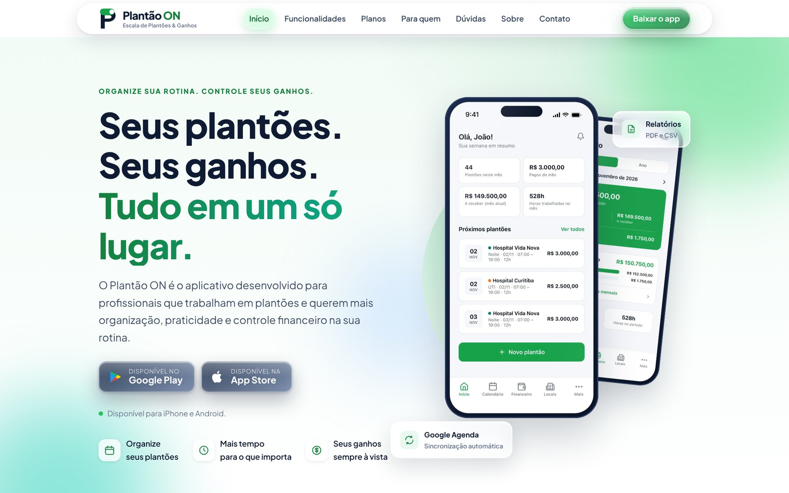
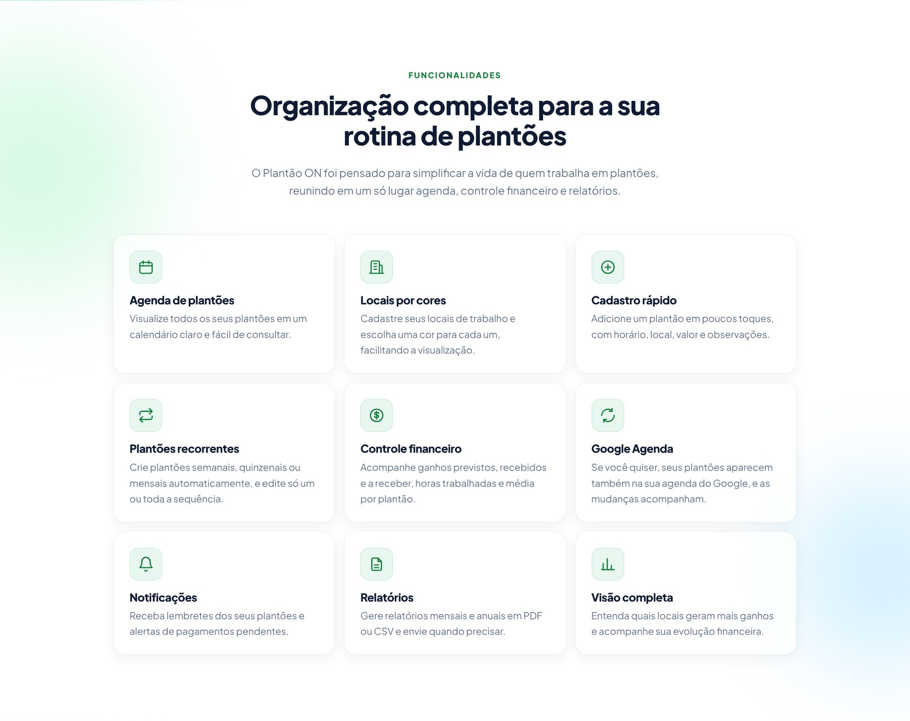
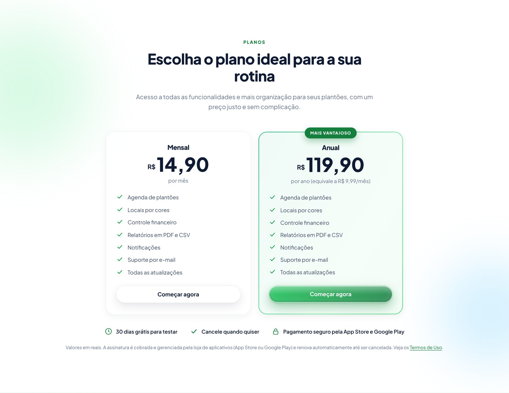
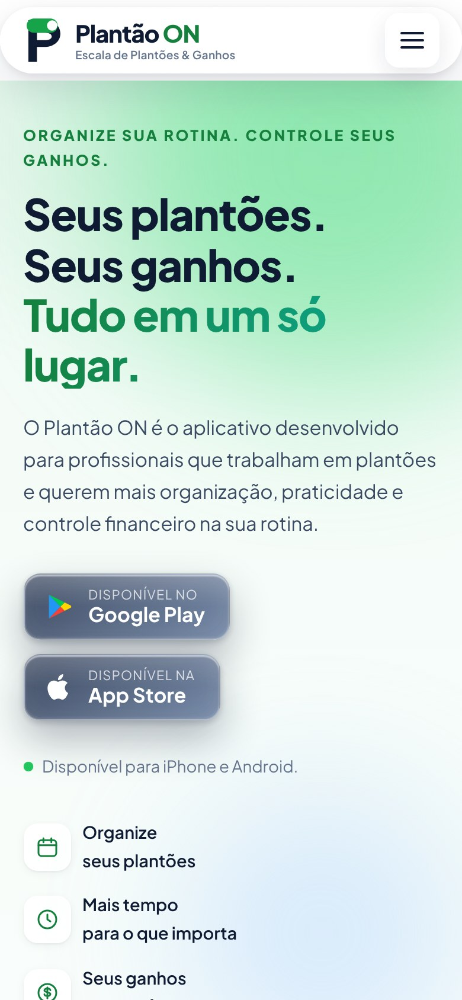

<div align="center">

# Plantão ON — Site oficial

**Organize sua rotina. Controle seus ganhos.**
Site de apresentação do aplicativo Plantão ON: agenda de plantões, locais por cores, controle financeiro e relatórios em um só lugar.

[](https://plantaoon.imtmed.com.br)
[](https://apps.apple.com/br/app/plant%C3%A3o-on/id6827799854)
[](https://play.google.com/store/apps/details?id=com.imttech.plantaoon)


<br>



</div>

---

## Sobre

O **Plantão ON** é um aplicativo para profissionais que trabalham em plantões, em qualquer área, e querem mais organização, praticidade e controle financeiro na rotina.

Este repositório contém o **site institucional** do app. Ele reúne a apresentação do produto, os planos, as dúvidas frequentes, as páginas legais e um formulário de contato. O site é estático, leve, sem framework, e foi pensado para carregar rápido e funcionar bem no celular.

> O código do aplicativo móvel **não** está neste repositório.

## O que o site tem

| Seção | O que mostra |
| --- | --- |
| **Início** | Apresentação do app, botões da App Store e do Google Play e destaques rápidos. |
| **Funcionalidades** | Agenda, locais por cores, cadastro rápido, plantões recorrentes, controle financeiro, Google Agenda, notificações e relatórios. |
| **Planos** | Mensal e anual, com 30 dias grátis para testar. |
| **Para quem** | Perfis de profissionais que mais se beneficiam do app. |
| **Dúvidas** | FAQ em formato sanfona, com contas, planos, cancelamento e dados. |
| **Sobre e Contato** | História do projeto e formulário de contato com envio por e-mail. |
| **Páginas legais** | Política de Privacidade, Termos de Uso e página para solicitar exclusão de conta. |

<div align="center">

&nbsp;

</div>

## Destaques técnicos

- **Sem dependências de build.** HTML, CSS e JavaScript puros, sem framework e sem bundler. Basta subir os arquivos.
- **Responsivo.** Layout testado de celular a desktop, sem rolagem horizontal.
- **Visual moderno.** Efeito de vidro (*glass*) nos botões, cartões e menu, tipografia Plus Jakarta Sans servida localmente e animações de entrada com `IntersectionObserver`.
- **Animações com cuidado.** Respeita `prefers-reduced-motion`, e as animações são desligadas para quem prefere menos movimento.
- **Troca de celulares na tela inicial.** Clicar no celular de trás faz os dois trocarem de lugar com uma animação em arco (Web Animations API).
- **Imagens em WebP**, com tamanhos declarados para evitar saltos de layout.
- **Acessibilidade.** HTML semântico, foco visível, `aria-label` nos controles interativos e navegação por teclado.
- **SEO.** Metadados, Open Graph, dados estruturados (JSON-LD `MobileApplication`), `sitemap.xml`, `robots.txt` e `site.webmanifest`.
- **Segurança e desempenho** (`.htaccess`): HTTPS forçado, cabeçalhos de segurança, compressão e cache de arquivos estáticos.
- **Formulário de contato seguro.** O PHP envia a mensagem pela API do [Resend](https://resend.com), e a chave fica **fora** da pasta pública.

<div align="center">

</div>

## Estrutura do projeto

```text
.
├── index.html              # Página principal
├── termos.html             # Termos de Uso
├── privacidade.html        # Política de Privacidade
├── excluir-conta.html      # Solicitação de exclusão de conta
├── 404.html                # Página de erro
├── api/
│   ├── contato.php         # Endpoint do formulário de contato
│   └── config.sample.php   # Modelo da configuração privada
├── css/styles.css          # Estilos
├── js/main.js              # Interações, animações e formulário
├── assets/
│   ├── fonts/              # Plus Jakarta Sans (local)
│   └── img/                # Imagens, ícones e logos
├── docs/                   # Capturas de tela usadas neste README
├── .htaccess               # HTTPS, cache, compressão e segurança
├── robots.txt
├── sitemap.xml
└── site.webmanifest
```

## Como rodar localmente

Não precisa instalar nada. Escolha uma opção:

```bash
# Python
python3 -m http.server 8080

# ou Node
npx serve .
```

Depois abra `http://localhost:8080`. Também funciona com a extensão **Live Server** do VS Code.

> O formulário de contato depende do PHP e da chave do Resend, por isso só envia e-mail em um servidor configurado. Localmente, o restante do site funciona normalmente.

## Publicação (Hostinger)

1. Crie o subdomínio no hPanel, em **Domínios → Subdomínios**.
2. No Gerenciador de Arquivos, abra a pasta do subdomínio.
3. Envie o conteúdo do projeto, incluindo o `.htaccess`. Não envie a pasta `docs/`, que é só para este README.
4. Confira se o SSL do subdomínio está ativo.
5. Após atualizar `css/` ou `js/`, aumente o `?v=` nos links do `index.html` para o navegador baixar os arquivos novos.

### Configurar o formulário de contato

1. Copie `api/config.sample.php` para **fora** da pasta pública, um nível acima do site, com o nome `plantaoon-config.php`.
2. Preencha a chave do Resend e o remetente:

   ```php
   return [
       'resend_api_key' => 're_...',
       'from'           => 'Plantão ON <nao-responda@seudominio.com.br>',
   ];
   ```
3. O remetente precisa ser de um domínio **verificado** no Resend.

> 🔒 Nunca coloque a chave dentro da pasta pública nem no Git.

## Licença e direitos

Todos os direitos reservados. O código, o texto, as imagens e a marca **Plantão ON** pertencem aos seus titulares e **não** podem ser copiados, redistribuídos ou usados em outros projetos sem autorização.

---

<div align="center">

**Plantão ON** · Escala de Plantões & Ganhos
Desenvolvido por Joca para Migliorini Teixeira Health Tech Ltda.

</div>
